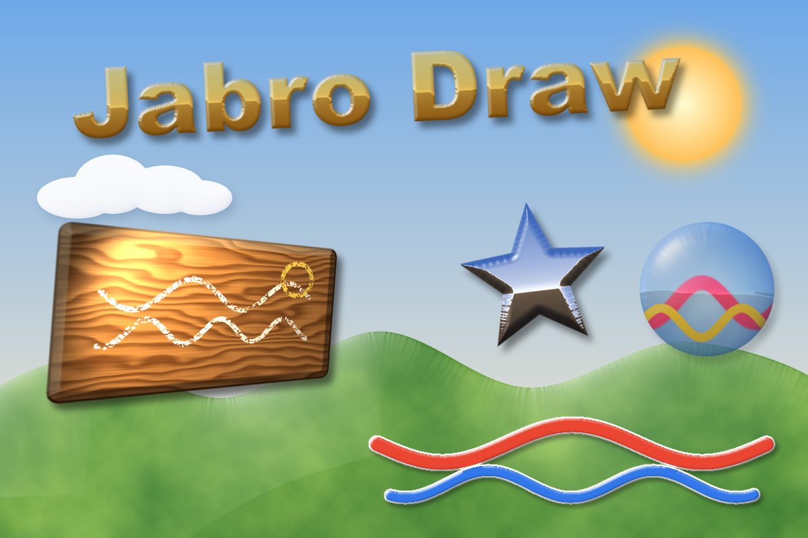
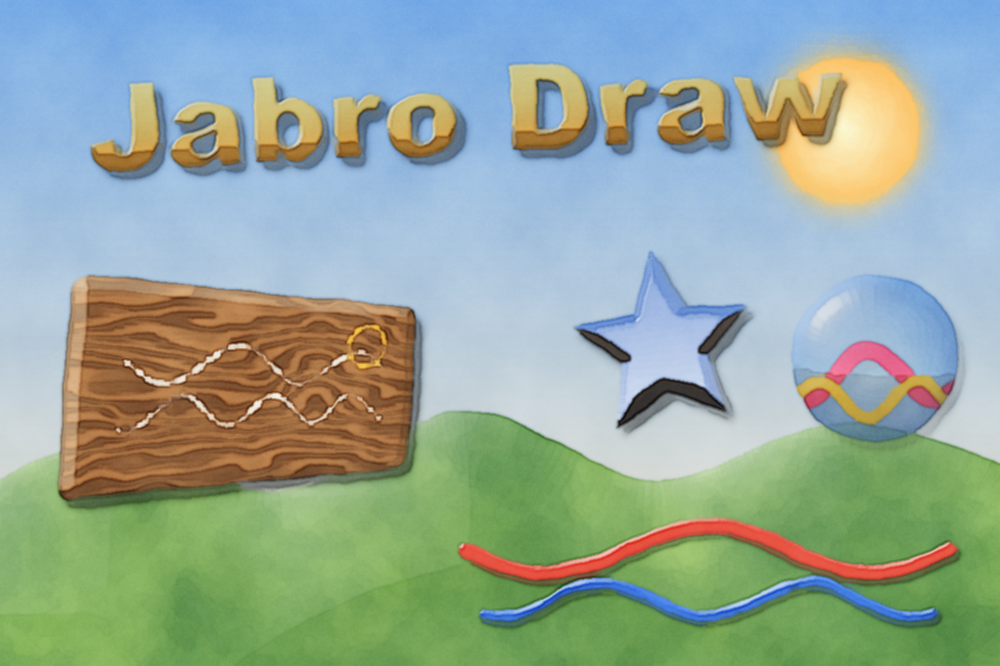
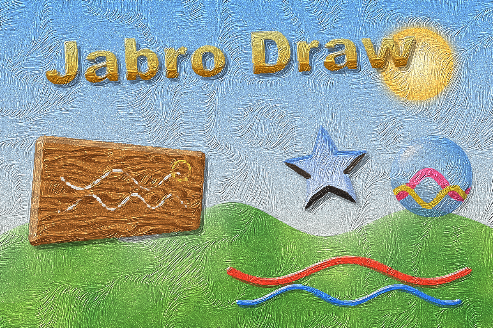
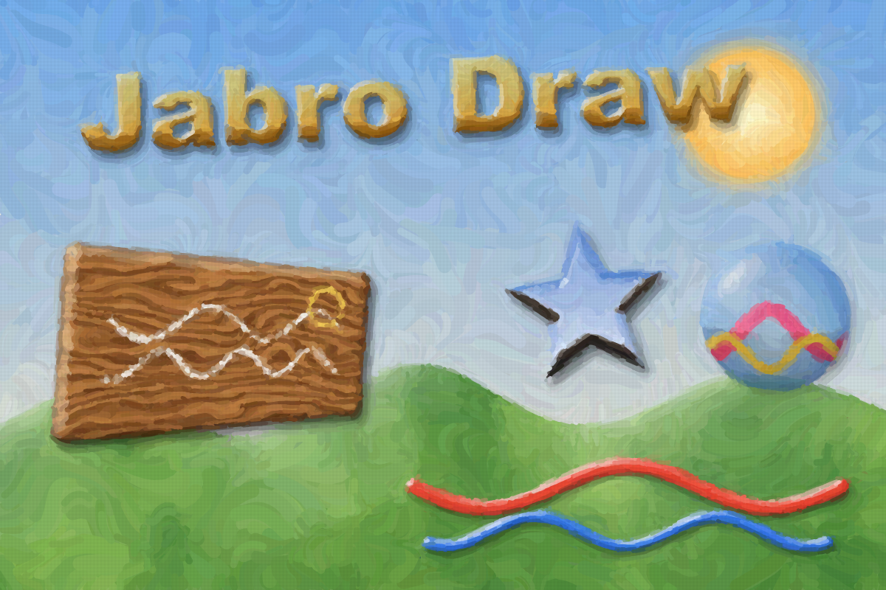
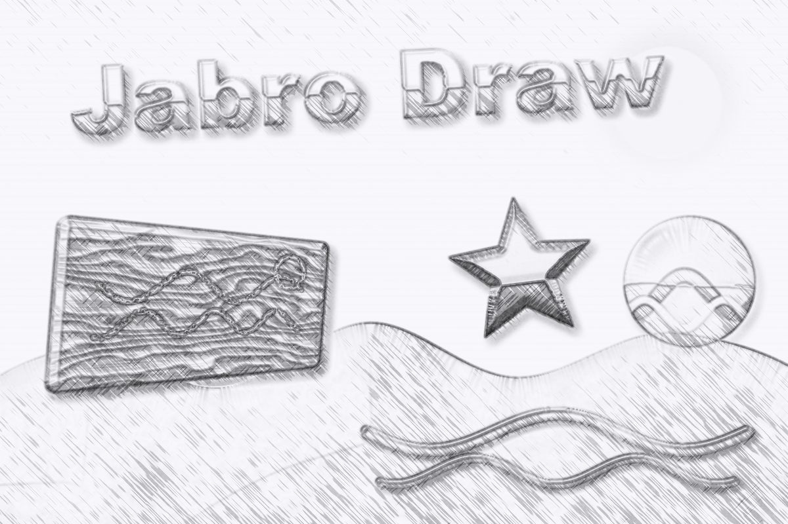
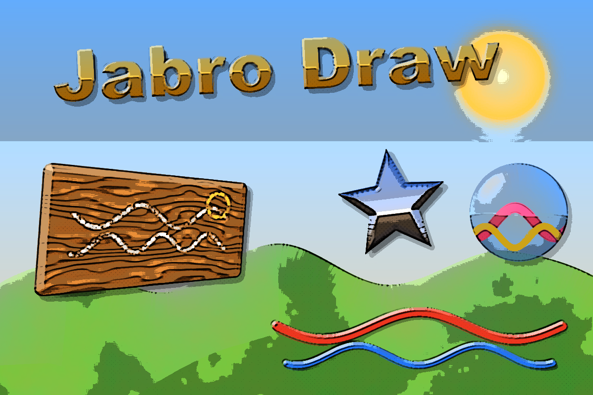
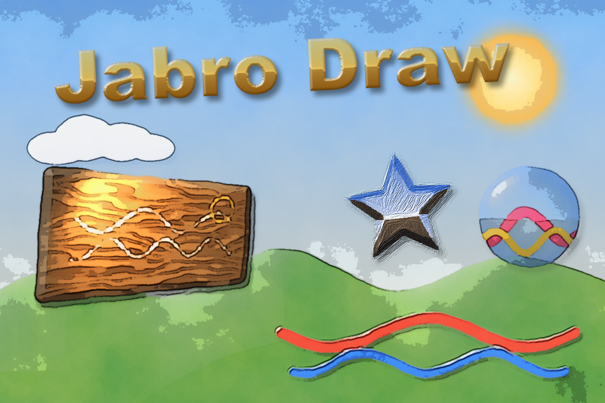

# Jabro Draw

A hybrid **vector + paint** graphics editor written in Rust, inspired by the workflow of classic
hybrid editors such as Real-DRAW PRO (an independent program — no code or assets are shared):

- draw **vector shapes and text** that stay editable
- give them **materials**: bevels (round, chisel, cove, ridge, pillow), gloss, chrome reflection,
  procedural textures (wood, marble, stone, canvas, clouds…), drop shadows and glows
- **paint on them** with brushes. The paint is clipped to the shape and stays attached to it.
- bend any object into **perspective** by dragging its corners, and the paint follows
- render the whole picture through an **NPR look**: watercolor, oil paint, impressionist
  strokes, pointillism, pencil, colored pencil or comic ink

| Clean | Watercolor | Oil |
|---|---|---|
|  |  |  |
| **Impressionist** | **Pencil** | **Comic ink** |
|  |  |  |

**Mixed looks in one picture:** watercolor with ink outlines for the page, the title kept clean,
and the star oil-painted on its own.



## Build & run

Requires Rust (stable) and, on Windows, the MSVC build tools.

```bash
cargo run --release
```

The editor opens with an editable demo scene. Headless render of the demo scene (handy for tests):

```bash
cargo run --release -- --render-demo out.png watercolor
```

Styles: `none watercolor oil impressionist pointillism pencil colorpencil comic`.

## Using it

| Key | Tool |
|---|---|
| V | Select. Drag to move; handles scale (Shift keeps the aspect); the round handle rotates (Shift snaps to 15°). Shift+click or drag a box on empty canvas to select several objects. |
| A | Edit nodes. Drag nodes and Bézier handles (Alt breaks a smooth handle). Click a segment to add a node, double-click a node to switch smooth/corner, Del removes it. |
| P | Pen. Click for corners, click+drag for curves. **Right-click** (or click the first node) closes the gap and fills the shape, Enter for an open stroke, Backspace removes the last node, Esc cancels. |
| Q | Perspective. Drag the 4 orange corners. |
| R / E / S | Rectangle / ellipse / star-polygon. Drag to draw, or click for a default size. |
| F | Freehand closed shape (becomes a smooth vector curve). |
| T | Text. Edit the text and font in the properties panel. |
| B | Brush. Paints into the selected object, or into a new paint layer. Alt+click picks a colour. |
| G | Gradient. Drag across an object to lay its fill gradient (linear or radial), then drag the handles. Add, move and recolour stops on the gradient bar in Fill. |
| X | Transparency. Drag across an object to fade it: opaque where you start, transparent where you let go (linear or radial). Drag the two handles to adjust. |
| L | Lights. Click an object to add a point light, spotlight or distant light; drag the lamp to move it, the spotlight's diamond to aim it. |

- **Changing an object later**: select it and use the **Shape** section at the top of the properties
  panel (corner radius, star sides/depth, text + **Font**). **Double-click** an object to reshape it:
  rectangles, ellipses and stars become editable paths in the node tool, and text jumps to its text
  field. With the Text tool active, the left panel's Font list also changes the selected text.
- **Pictures**: File › Import picture (Ctrl+I), or drag image files onto the window (PNG, JPEG, WebP,
  BMP, GIF, TIFF, TGA, ICO). A picture is a normal object, so you can bevel, outline, light, paint
  on and perspective-bend it. Its **Remove background** button hides everything around the subject
  that has the border's colour, and **Remove background (AI)** finds the main subject even on busy
  photos (U²-Net, built in and run offline; Best or Fast). **Reset brush work** returns a picture
  to how it was imported. The Brush tool's **Magic wand** clicks away single areas, and
  **Transparency: hide / reveal** paints transparency by hand on any object. All of this goes into a
  mask, so the original pixels are never destroyed (Clear / Invert under Transparency).
- **Picture textures**: Fill › Texture › Image file… fills any shape with a picture (stretched or
  tiled). Transparency › Texture › Image file… uses a picture's brightness as opacity.
- **Transparency** (properties panel): flat, linear, radial or texture, with start and end opacity,
  like a fill. It follows the object's perspective and also thins its shadow and glow.
- **Lights** (properties panel): any number of coloured point, spot and distant lights per object,
  plus ambient light and shine. They also light the bevel relief.
- **Outline**: outside, centred or inside the edge, solid, dashed or dotted. On paint layers it
  traces around everything painted.
- **Canvas**: File › New… (Ctrl+N) and Canvas › Canvas size… offer templates for screen, social,
  photo and print sizes (16:9, 1:1, 4:5, 9:16, A4/Letter at 300 dpi…), an aspect lock and an
  anchor for which side the canvas grows from. **Fit canvas to content** wraps the canvas around
  everything, and **Grow automatically** (a remembered setting) extends the canvas when you drop an
  object past its edge. The status bar shows the size; click it to change it.
- **Snapping & layout** (View menu): moving, resizing, drawing and node editing snap to the canvas
  edges and centre, other objects' edges and centres, guides and an optional grid. Pink lines show
  the match, and Alt bypasses snapping. **Rulers**: drag from a ruler to make a guide, drop it back
  to remove it. **Arrange** (properties panel): align left, centre, right, top, middle or bottom (a
  single object aligns to the canvas), and give 3+ objects equal spacing.
- **Blend modes and colour adjustments** per object: 16 blend modes (multiply, screen, overlay, soft
  light, colour…) plus non-destructive hue, saturation, lightness, contrast and levels (black point,
  white point, midtones).
- **NPR per object and stacked looks**: every object can follow the document's look, stay clean, or
  get its own look (properties › NPR look). The look bar can layer up to three looks, such as
  watercolor washes with comic-ink outlines on top. Strokes spill slightly past an object's edges,
  like real paint.
- **Never lose work**: unsaved changes are written to a recovery file every minute, in the
  background. If Jabro Draw is closed unexpectedly, the next start offers to recover the drawing.
  File › **Open recent** lists the last 10 files.
- **Export** (File › Export…, Ctrl+E):
  - **Formats:** PNG, JPEG (with quality), WebP, SVG, or a layered PSD with one named layer per
    object.
  - **Resolution:** 1–8×, staying crisp because objects, text and effects are re-rendered (NPR
    brushes scale too).
  - **Options:** transparent background, selection only, and whether to include the NPR look.
  - **SVG:** plain shapes and text stay real vectors; objects with effects SVG can't express are
    embedded as pictures.
- **Groups** (Ctrl+G / Ctrl+Shift+G): click any member to select the whole group, Ctrl+click
  for a single member. A group or multi-selection gets one box to scale and rotate. With the
  Perspective tool you can bend them all at once.
- **Linked clones** (Ctrl+Shift+D): copies that share their look. Edit any one (fill, bevel,
  paint, nodes…) and all copies follow, each keeping its own position and size. Detach makes one
  independent again.
- **Copy / cut / paste** (Ctrl+C / X / V): objects paste back as editable objects, even into
  another document. Other programs receive a transparent picture of the selection. Pasting a
  screenshot or an image copied elsewhere adds it as a picture, and pasting text creates a text
  object.
- **Objects list**: drag a row up or down to change the stacking order; dragging a selected row
  moves the whole selection. Shift+click adds to the selection, and the checkbox hides an object.
- **Path menu**: Union / Subtract / Intersect / Exclude on 2+ selected objects (also in the properties
  panel). The result is one editable path that keeps the bottom object's style. **Convert to path**
  (Ctrl+Shift+C) turns rectangles, ellipses, stars and text into editable nodes, and keeps perspective.
- Mouse wheel zooms, middle-drag or Space+drag pans, and `0` fits the view.
- Ctrl+Z / Ctrl+Y undo/redo, Ctrl+D duplicates, Del deletes, Ctrl+S saves (`.jabro`), Ctrl+O opens, Ctrl+E exports a PNG.
- The **NPR look** bar at the top applies to the whole picture. The "painting…" spinner shows
  while the look renders in the background.

## Tests

```bash
cargo test --release
```

See [docs/DESIGN.md](docs/DESIGN.md) for the research notes on Real-DRAW PRO, the architecture
and the roadmap.

## Licenses

Jabro Draw has no license chosen yet (all rights reserved by its author). The open-source parts it
is built from, including the embedded U²-Net AI model, are listed with their licenses in
[THIRD_PARTY_NOTICES.md](THIRD_PARTY_NOTICES.md). Ship that file and the `licenses/` folder with
every copy of the program you distribute.

The AI model files (176 MB) are too big for git. The first build downloads them once from the
rembg project and verifies their checksums (`crates/jabro-models/build.rs`).
