<p align="center">
  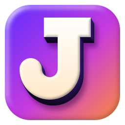
</p>

<h1 align="center">Jabro Draw</h1>

<p align="center">
  <b>Vector shapes you can paint on.</b><br>
  A hybrid vector + paint editor for Windows, written in Rust: bevels, textures, 3D, perspective,
  painterly looks and offline AI tools in one program.
</p>

Jabro Draw brings the playful workflow of the classic hybrid drawing programs of the 2000s into a
modern 64-bit program. It is written from scratch and shares no code or assets with any other
program.

- Draw **vector shapes and text** that stay editable.
- Give them **materials**: bevels (round, chisel, cove, ridge, pillow), gloss, chrome reflection,
  procedural textures (wood, marble, stone, canvas, clouds…), lights, drop shadows, glows and
  **3D extrusion**.
- **Paint on them** with brushes. The paint is clipped to the shape and stays attached to it.
- Bend any object into **perspective**, warp or liquify it, and the paint follows.
- Render the whole picture through one of **18 NPR looks**: watercolor, oil, gouache,
  impressionist strokes, pointillism, pastel, pencil, colored pencil, sumi-e ink wash, comic ink,
  pop-art halftone, linocut, engraving, risograph, paper cut-out, stained glass, chalkboard
  and blueprint.
- Keep objects in a **gallery** and reuse them in any drawing, or send them to someone as a file.

> **Status:** early preview (0.1). Everything described here works, but expect rough edges.
> Bug reports and ideas are welcome in the issues.

| Clean | Watercolor | Oil |
|---|---|---|
|  |  |  |
| **Impressionist** | **Pencil** | **Comic ink** |
|  |  |  |

**Mixed looks in one picture:** watercolor with ink outlines for the page, the title kept clean,
and the star oil-painted on its own.


**Print and craft looks:**

| Pop-art halftone | Linocut | Engraving |
|---|---|---|
| 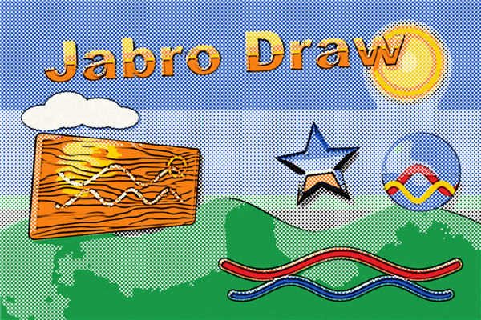 | 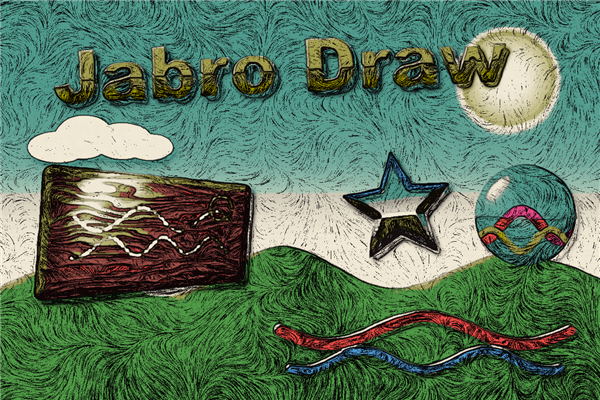 | 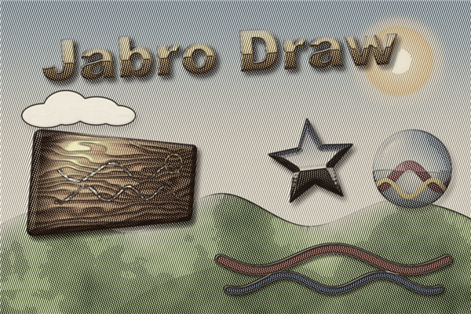 |
| **Risograph** | **Paper cut-out** | **Stained glass** |
| 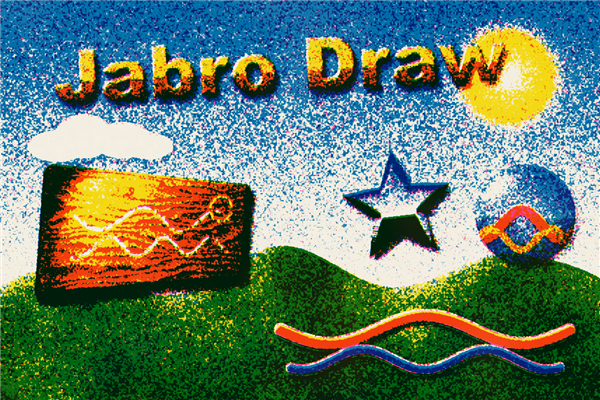 | 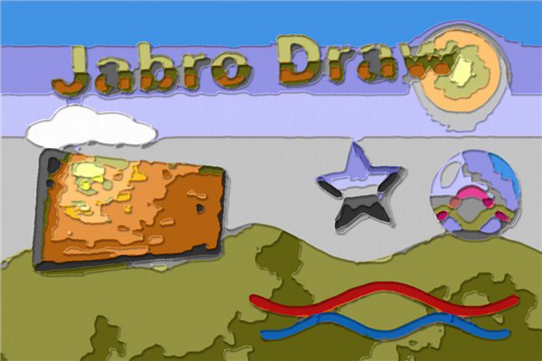 | 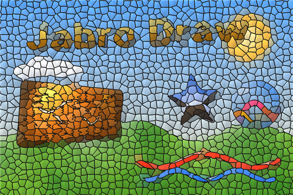 |
| **Gouache** | **Pastel & charcoal** | **Sumi-e** |
| 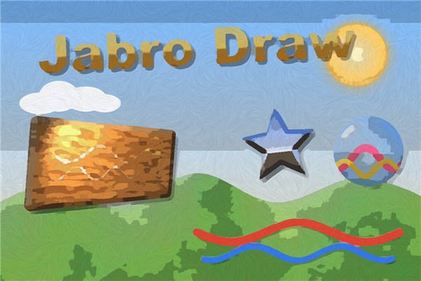 | 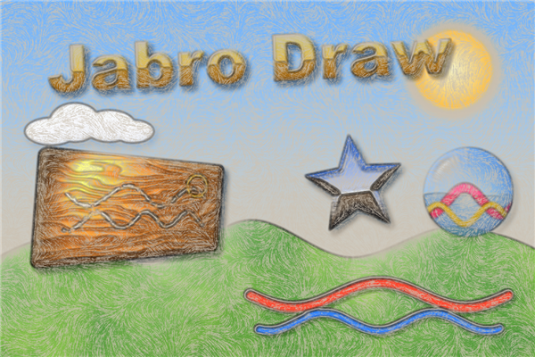 | 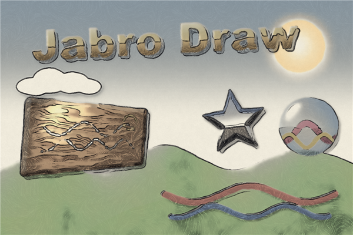 |
| **Chalkboard** | **Blueprint** | |
| 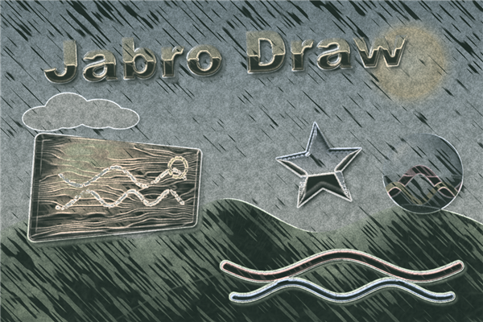 | 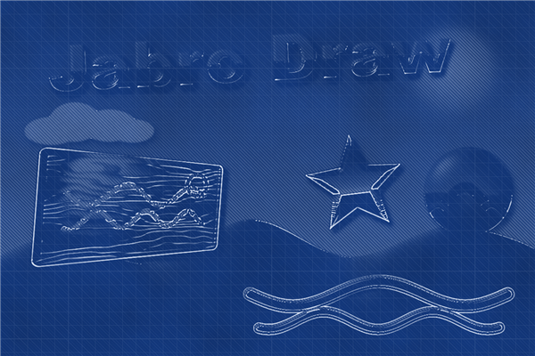 | |

## Highlights

- **Vector tools**: pen with Bézier curves, node editing, union / subtract / intersect / exclude,
  text with spacing, alignment, arcs and **text on a path**, and a library of ready-made shapes.
- **Painting**: round, airbrush, chalk, smudge and eraser brushes, wet **watercolor** that pools
  and mixes, a **scatter** brush for leaves, grass and stars, and **symmetry** painting (mirror,
  4-way, radial, kaleidoscope).
- **Pictures with offline AI**: background removal, **click-to-select** an object in a photo,
  **2× / 4× enlarging** with real detail, and **trace to vectors**. The AI models are built into the
  program and run on your own computer.
- **Animation**: keyframes for position, size, rotation, perspective and opacity, exported as
  an animated GIF or PNG frames, plus a **painting time-lapse** of your work.
- **Files**: opens PNG, JPEG, WebP, JPEG XL, QOI, BMP, GIF, TIFF, TGA and ICO, plus HEIC, AVIF
  and camera RAW through Windows' own codecs. Exports PNG, JPEG, WebP, AVIF, SVG and layered PSD
  at up to 8× resolution.
- **Gallery**: objects you want again, with their paint, effects and animation, one click away in
  every drawing. Each item is a small `.jabro` file, so a gallery can be shared.

**Private by design:** Jabro Draw never connects to the internet. Your pictures stay on your
computer, and there is no account, telemetry or update check.

## Download

Jabro Draw runs on 64-bit Windows (it is developed and tested on Windows 11).

1. Download `Jabro-Draw-<version>-Setup.exe` from the
   [Releases](https://github.com/jensbroecher/JabroDraw/releases) page.
2. Run it. Windows may say "Windows protected your PC" because the installer is not signed with a
   paid certificate: click **More info → Run anyway**.
3. It installs for your user only, without admin rights, and adds Start menu and desktop
   shortcuts and the `.jabro` file type. Uninstall it from **Settings › Apps**.

## Build from source

Requires Rust (stable) and, on Windows, the MSVC build tools.

```bash
cargo run --release
```

The first build downloads the AI models once (see [Licenses](#licenses)).

To make an installer you can send to someone (`dist\Jabro-Draw-<version>-Setup.exe`, which
installs per user without admin rights and adds Start menu entries, an uninstaller and the
`.jabro` file type):

```bash
powershell -ExecutionPolicy Bypass -File tools/make-installer.ps1
```

The app icon is drawn with Jabro Draw itself; `--make-icon assets` re-renders it.

The editor opens with an editable demo scene. Headless render of the demo scene (handy for tests):

```bash
cargo run --release -- --render-demo out.png watercolor
```

Styles: `none watercolor oil gouache impressionist pointillism pastel pencil colorpencil sumie comic
popart linocut engraving riso papercut glass chalkboard blueprint` (or `mixed` for the picture above).

## Using it

| Key | Tool |
|---|---|
| V | Select. Drag to move; handles scale (Shift keeps the aspect); the round handle rotates (Shift snaps to 15°). Shift+click or drag a box on empty canvas to select several objects. |
| A | Edit nodes. Drag nodes and Bézier handles (Alt breaks a smooth handle). Click a segment to add a node, double-click a node to switch smooth/corner, Del removes it. |
| P | Pen. Click for corners, click+drag for curves. **Right-click** (or click the first node) closes the gap and fills the shape, Enter for an open stroke, Backspace removes the last node, Esc cancels. |
| Q | Perspective. Drag the 4 orange corners. |
| R / E / S | Rectangle / ellipse / star-polygon. Drag to draw, or click for a default size. |
| F | Freehand closed shape (becomes a smooth vector curve). |
| T | Text. Edit the text and font in the properties panel. |
| B | Brush. Paints into the selected object, or into a new paint layer. Alt+click picks a colour. **Symmetry** paints mirrored, 4-way, radial or kaleidoscope copies of every stroke around the object's centre. Besides round, airbrush, chalk, smudge and eraser there is **Watercolor** (wet washes that pool at the edges and mix where strokes overlap) and a **Scatter** image hose that sprays leaves, grass, stars, hearts, flowers or confetti, each with its own size, angle and shade. |
| G | Gradient. Drag across an object to lay its fill gradient (linear or radial), then drag the handles. Add, move and recolour stops on the gradient bar in Fill. |
| X | Transparency. Drag across an object to fade it: opaque where you start, transparent where you let go (linear or radial). Drag the two handles to adjust. |
| L | Lights. Click an object to add a point light, spotlight or distant light; drag the lamp to move it, the spotlight's diamond to aim it. |
| W | Warp. Drag the grid points to bend an object freely, on top of its perspective. Grid density and Reset warp are in the tool panel. |
| J | Liquify. Paint over an object to push (Move), bloat (Grow), pinch (Shrink) or twirl it. Shapes, text, paint and effects bend together and stay editable. |

- **Changing an object later**: select it and use the **Shape** section at the top of the properties
  panel (corner radius, star sides/depth, text + **Font**). **Double-click** an object to reshape it:
  rectangles, ellipses and stars become editable paths in the node tool, and text jumps to its text
  field. With the Text tool active, the left panel's Font list also changes the selected text.
- **Text layout**: letter spacing, line spacing and left / centre / right alignment, plus an
  **Arc** slider that bends the text into an arch or a smile. **Text on path** (Path menu): select a
  text and any shape or pen path, and the letters follow its outline. Position, side and lift are
  in the properties panel, and **Take off path** straightens it again. The letters keep their size
  through all of this, and the text stays retypable.
- **3D extrude** (properties panel): solid sides with depth, direction, perspective (a back that
  recedes towards a vanishing point), light direction and depth shading. The sides take the
  object's own colours or a colour you pick. It works on shapes, text, pictures and paint, follows
  perspective and warps, and the drop shadow falls from the whole 3D body. Add a bevel for rounded
  front edges.
- **Pictures**: File › Import picture (Ctrl+I), or drag image files onto the window (PNG, JPEG, WebP,
  JPEG XL, QOI, BMP, GIF, TIFF, TGA, ICO, plus HEIC/HEIF, AVIF, JPEG XR and camera RAW through
  Windows' own codecs when they are installed). A picture is a normal object, so you can bevel, outline, light, paint
  on and perspective-bend it. Its **Remove background** button hides everything around the subject
  that has the border's colour, and **Remove background (AI)** finds the main subject even on busy
  photos (U²-Net, built in and run offline; Best or Fast). **Reset brush work** returns a picture
  to how it was imported. The Brush tool's **Magic wand** clicks away single areas, and
  **Transparency: hide / reveal** paints transparency by hand on any object. All of this goes into a
  mask, so the original pixels are never destroyed (Clear / Invert under Transparency).
- **AI object select** (Brush tool): click an object in a photo and the AI finds its outline. You
  can keep only it, hide it, or copy it out as a new object. Shift+click adds to the selection and
  Alt+click takes a part away. The first click on a picture takes a few seconds; after that it's
  instant. **Enlarge with AI** (Picture section) makes a picture 2× or 4× bigger with real detail
  instead of blur (Real-ESRGAN, up to 4096 px). Both run offline, like the background removal.
- **Trace to vectors** (Picture section): turns a picture or paint layer into editable vector
  shapes, one per colour (1–16), grouped and in the picture's place and perspective. Detail,
  smoothness and speck size are adjustable. The colour layers are stacked so no gaps show between
  neighbours, and the picture is only hidden, not deleted. The tracer is Jabro Draw's own code.
- **Picture textures**: Fill › Texture › Image file… fills any shape with a picture (stretched or
  tiled). Transparency › Texture › Image file… uses a picture's brightness as opacity.
- **Transparency** (properties panel): flat, linear, radial or texture, with start and end opacity,
  like a fill. It follows the object's perspective and also thins its shadow and glow.
- **Lights** (properties panel): any number of coloured point, spot and distant lights per object,
  plus ambient light and shine. They also light the bevel relief.
- **Outline**: outside, centred or inside the edge, solid, dashed or dotted. On paint layers it
  traces around everything painted.
- **Canvas**: File › New… (Ctrl+N) and Canvas › Canvas size… offer templates for screen, social,
  photo and print sizes (16:9, 1:1, 4:5, 9:16, A4/Letter at 300 dpi…), an aspect lock and an
  anchor for which side the canvas grows from. **Fit canvas to content** wraps the canvas around
  everything, and **Grow automatically** (a remembered setting) extends the canvas when you drop an
  object past its edge. The status bar shows the size; click it to change it.
- **Snapping & layout** (View menu): moving, resizing, drawing and node editing snap to the canvas
  edges and centre, other objects' edges and centres, guides and an optional grid. Pink lines show
  the match, and Alt bypasses snapping. **Rulers**: drag from a ruler to make a guide, drop it back
  to remove it. **Arrange** (properties panel): align left, centre, right, top, middle or bottom (a
  single object aligns to the canvas), and give 3+ objects equal spacing.
- **Blend modes and colour adjustments** per object: 16 blend modes (multiply, screen, overlay, soft
  light, colour…) plus non-destructive hue, saturation, lightness, contrast and levels (black point,
  white point, midtones).
- **NPR looks**: besides the painterly looks (watercolor, oil, gouache, impressionist,
  pointillism, pastel) and the drawn ones (pencil, colored pencil, sumi-e, comic ink), there are
  print and craft looks: **pop-art halftone** (flat colours from dot screens with black
  outlines), **linocut** (black ink and a flat second colour, gouged lines in the mid-tones),
  **engraving** (lines that swell with the shadows and bulge over the forms), **risograph**
  (three grainy inks out of register), **paper cut-out** (flat paper layers with drop shadows),
  **stained glass** (pieces that follow the edges, set in lead), **chalkboard** and
  **blueprint**. The two sliders mean what fits the look (brush size, dot size, line spacing, piece
  size; paper, canvas, glass texture, chalk dust), and **Vary** rolls new marks.
- **NPR per object and stacked looks**: every object can follow the document's look, stay clean, or
  get its own look (properties › NPR look). The look bar can layer up to three looks, such as
  watercolor washes with comic-ink outlines on top. Strokes spill slightly past an object's edges,
  like real paint. The look shows up as a quick preview first and is then painted at full
  quality. When the preview keeps up, it stays live while you drag.
- **Gallery** (View › Gallery, or Edit › Add to gallery…): select objects and press **+ Add
  selection** to keep them, with a name and a category. Click an item to put it into the
  picture, or drag it onto the canvas where you want it; it comes back as editable objects with
  its paint, effects, groups and animation. Right-click an item to rename or remove it, or to
  **save a copy to share**: every item is a small `.jabro` file, so you can e-mail it, and
  whoever gets it drops it onto their gallery (or uses **Import…**). Any drawing can be imported
  as an item too. The gallery lives in `%APPDATA%\JabroDraw\gallery`.
- **Animation** (View › Animation timeline): select objects, press **Add keyframe**, go to another
  frame and move, scale, rotate, perspective-bend or fade them. That frame keys itself. Play it
  back with easing, scrub the keyframe strip, and export an animated GIF or numbered PNG frames for
  a video editor (File › Export animation, or Export… in the timeline), optionally with the NPR
  look and at a larger size.
- **Painting time-lapse** (File › Painting time-lapse…): while you work, Jabro Draw records small
  snapshots of the canvas (one per change, and a few during long brush strokes). Save them as a GIF
  or PNG frames of any length. The recording lasts for the session and is not saved in the file.
- **Never lose work**: unsaved changes are written to a recovery file every minute, in the
  background. If Jabro Draw is closed unexpectedly, the next start offers to recover the drawing.
  File › **Open recent** lists the last 10 files.
- **Export** (File › Export…, Ctrl+E):
  - **Formats:** PNG, JPEG (with quality), WebP, AVIF (small modern files, with quality), SVG,
    or a layered PSD with one named layer per object.
  - **Resolution:** 1–8×, staying crisp because objects, text and effects are re-rendered (NPR
    brushes scale too).
  - **Options:** transparent background, selection only, and whether to include the NPR look.
  - **SVG:** plain shapes and text stay real vectors; objects with effects SVG can't express are
    embedded as pictures.
- **Groups** (Ctrl+G / Ctrl+Shift+G): click any member to select the whole group, Ctrl+click
  for a single member. A group or multi-selection gets one box to scale and rotate. With the
  Perspective tool you can bend them all at once.
- **Linked clones** (Ctrl+Shift+D): copies that share their look. Edit any one (fill, bevel,
  paint, nodes…) and all copies follow, each keeping its own position and size. Detach makes one
  independent again.
- **Copy / cut / paste** (Ctrl+C / X / V): objects paste back as editable objects, even into
  another document. Other programs receive a transparent picture of the selection. Pasting a
  screenshot or an image copied elsewhere adds it as a picture, and pasting text creates a text
  object.
- **Objects list**: drag a row up or down to change the stacking order; dragging a selected row
  moves the whole selection. Shift+click adds to the selection, and the checkbox hides an object.
- **Path menu**: Union / Subtract / Intersect / Exclude on 2+ selected objects (also in the properties
  panel). The result is one editable path that keeps the bottom object's style. **Convert to path**
  (Ctrl+Shift+C) turns rectangles, ellipses, stars and text into editable nodes, and keeps perspective.
- Mouse wheel zooms, middle-drag or Space+drag pans, and `0` fits the view.
- Ctrl+Z / Ctrl+Y undo/redo, Ctrl+D duplicates, Del deletes, Ctrl+S saves (`.jabro`), Ctrl+O opens, Ctrl+E exports a PNG.
- The **NPR look** bar at the top applies to the whole picture. The "painting…" spinner shows
  while the look renders in the background.

## Tests

```bash
cargo test --release
```

See [docs/DESIGN.md](docs/DESIGN.md) for the design notes, the architecture and the roadmap.

## Licenses

Jabro Draw is free software under the [MIT License](LICENSE): use it, change it and pass it on,
as long as the licence note stays with it. The open-source parts it is built from, including the
embedded AI models (U²-Net, MobileSAM and Real-ESRGAN), are listed with their licenses in
[THIRD_PARTY_NOTICES.md](THIRD_PARTY_NOTICES.md). Ship that file and the `licenses/` folder with
every copy of the program you distribute.

The AI model files (about 230 MB) are too big for git. The first build downloads them once from
their publishers (the rembg project on GitHub, MobileSAM and Real-ESRGAN on Hugging Face) and
verifies their checksums (`crates/jabro-models/build.rs`).
